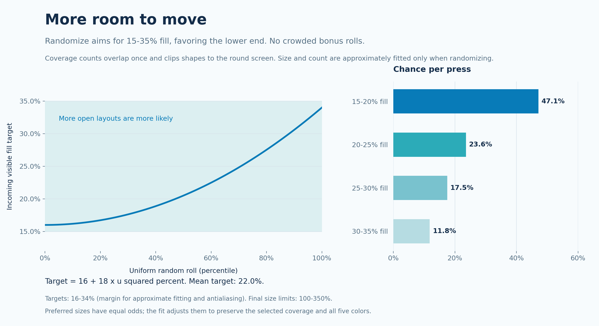

# Pendant fluid test

Aideepen ESP32-S3 Super Mini, standalone GC9A01 240 x 240 round display,
GY-521 MPU6050 module, and two momentary buttons. It starts with circles covering
about 22% of the screen, fitted from a preferred 300% visual size. Tilt moves the
fluid; the two buttons trigger an explosion or randomize the size, count, shape,
color swatch, and moving gradient background. The simulation replaces
the old sand grid with continuous positions, fluid pressure, light viscosity,
and momentum-preserving motion along the wall. Use the [IMU visualizer](../MPU_Visualizer/README.md)
to check the display and motion sensor and save a flat-bias calibration first.
Both sketches use the same board configuration, motion driver, and saved offsets.

The installed replacement GY-521 returns nonstandard identity 0x75. Both sketches
use the narrowly scoped compatibility setting in `shared/BoardConfig.h` while
retaining configuration-readback and fresh-data checks. Its exact chip model is
unconfirmed; see the [hardware observations](../HARDWARE.md#hardware-verification-status).

## Tilt color-wheel LED

The onboard addressable RGB LED on GPIO48 follows **physical tilt direction**,
independently of the fluid palette, manual gravity modes, and explosions.
It uses the same saved screen-axis mapping as the fluid:

| Tilt direction | Approximate LED color |
| --- | --- |
| Up | Blue |
| Up-right | Cyan |
| Right | Green |
| Down-right | Yellow-green |
| Down | Yellow |
| Down-left | Orange |
| Left | Red |
| Up-left | Magenta |

Colors blend between these eight anchors. Brightness ramps from off around
0.04g of in-plane tilt to a modest per-channel ceiling of 32/255 near 0.65g.
Level means the filtered X/Y gravity components are near zero, with either
face pointing up; it does not automatically redefine level at startup.
Existing sensor bias calibration still applies. Invalid, unready, disconnected,
or more than 150ms-old readings turn the LED off.

The shared `TiltColorWheel.h` uses fixed-point arithmetic, one variable integer
division for direction, and `max + 3/8 * min` for approximate tilt magnitude.
It needs no `atan2`, sine/cosine, square root, HSV conversion, new sensor reads,
or dynamic allocation. `TiltRgbLed.h` initializes Arduino's hardware RMT driver
once at startup, checks color at most 25 times per second, and writes only
changed RGB values. An invalid input can turn it off immediately between checks.
LED writes run on the input core after publishing the due LCD frame, outside
physics catch-up. Tune the rate, deadzone, full-tilt threshold, and brightness
cap in `shared/TiltColorWheel.h`.

## Wiring

Pin numbers are raw GPIO numbers printed on the Super Mini. The canonical
assignments are in [`shared/BoardConfig.h`](../shared/BoardConfig.h).

| Module pin | Super Mini |
| --- | --- |
| Display RST | GPIO4 |
| Display CS | GPIO1 |
| Display DC | GPIO2 |
| Display SDA / MOSI | GPIO9 |
| Display SCL / SCK | GPIO7 |
| Display VCC | 3V3 |
| Display GND | GND |
| GY-521 VCC | 3V3 |
| GY-521 GND | GND |
| GY-521 SDA | GPIO12 |
| GY-521 SCL | GPIO13 |
| Primary / explosion button | GPIO10 to GND |
| Randomize button | GPIO11 to GND |

The display's SDA/SCL labels refer to **SPI**, whereas the GY-521 uses **I2C**.
The seven-pin display header has no separate backlight pin. Leave the GY-521
INT and auxiliary XDA/XCL unconnected. AD0 low/default selects address 0x68;
high selects 0x69, which the driver also supports. Use secure contacts and a
common ground. See the [hardware catalog](../HARDWARE.md) for module specifications.

The code uses pull-ups and 25 ms debounce for the two normally open tactile
buttons. Each press triggers once; a held-at-startup button must be released
before it can trigger. The buttons are optional because serial commands provide
the same actions. Connect each switch between its GPIO and GND, without an
external pull-up. On a four-leg tactile switch, use contacts on opposite
internally connected sides; the two legs on the same side are already joined.
SPI MISO is disabled for the write-only display.

## Build and upload

From the repository root in PowerShell:

```powershell
.\upload-sand.ps1 -BuildOnly
.\upload-sand.ps1
```

The wrapper uses `upload-firmware.ps1`, compiles before uploading, and stores
build intermediates outside Dropbox. Close Serial Monitor before uploading.
The sole connected Espressif serial port is selected automatically. With multiple
boards, specify the intended port, for example `-Port COM32` for the latest
verified board.

Arduino settings: **ESP32S3 Dev Module**, 240 MHz CPU, 4 MB flash, DIO flash
mode, default 4 MB partition scheme, PSRAM disabled, Hardware CDC and JTAG,
USB CDC on boot enabled, and Arduino loop on core 1. The installed ESP32 core
is 3.3.12. Required libraries: Adafruit GC9A01A, Adafruit GFX, and Adafruit BusIO.
PSRAM is not required; MPU registers are accessed directly by the shared driver.

## Controls

The main screen has no IMU status lights, error flashes, waiting/manual-mode
indicators, or connection text. Error counts, connection details, and wiring
diagnostics remain available over serial. With no IMU, fluid falls toward the
bottom. Both IMU addresses are retried every two seconds; reconnection restores live tilt unless
a manual/demo mode is selected.

Serial monitor: 115200 baud, single-character commands.

| Input | Action |
| --- | --- |
| GPIO10 button / `e` | Apply an explosion to the current fluid |
| GPIO11 randomize button / `n` | Choose roughly 15-35% incoming fill, fit size/count, and randomize shape, stretch cap, swatch, and gradient effect |
| `r` | Reset the current size/population |
| `p` | Cycle the 21 locked color swatches and create a new gradient effect; The Great Wave (2/21) is the startup default |
| `g` | Reroll only the gradient effect, retaining the swatch and foreground simulation |
| `c` | Cycle circle, triangle, square, five-point star without changing size/count or stretch cap |
| `5`, `6`, `7`, `8`, `9` | Explicit size/count previews at 100%, 162.5%, 225%, 287.5%, 350% visual size |
| `!` | Fill the current size to its packed particle-count limit |
| `0` | Live IMU tilt, or downward fallback when disconnected |
| `1`, `2`, `3`, `4` | Force gravity down, left, up, right |
| `d` | Toggle rotating demo gravity |
| `s` | Swap motion X/Y axes |
| `x`, `y` | Reverse screen gravity X or Y |
| `v` | Toggle configured LCD SPI speed (default 20 MHz) and 8 MHz |
| `b` | Toggle the IMU I2C clock between 100 and 400 kHz for diagnosis |
| `i` | Scan I2C addresses |
| `m` | Report MPU identity, raw readings, and calibration |
| `k` | Report both button input levels, pull-ups, direction, and pin mux |
| `h` | Toggle extra shake agitation |
| `+`, `-` | Adjust shake strength, 0.25 to 3.0 |
| `t` | Apply a test jolt |
| `?` | Print help |

Axis corrections are saved for both sketches. The current COM35 default uses
`(+accelY, -accelX)` (swap=1, flipX=1, flipY=1), with defaults in
`shared/BoardConfig.h`. The sensor was turned face-down with its connector end
still at the top, so left/right is reversed relative to the COM33 mounting.
This correction is inferred from the owner's mounting description; physical
tilt directions still need checking once the display is wired.
Saved settings override defaults; serial `m` reports the active mapping and
whether all three stored values match it.
This mounting correction is independent of flat-bias calibration, which requires
the GY-521 itself to be level with its components facing upward.

## Button effects and size/count mapping

The primary button (`e`) gives the existing fluid one radial explosion. Each
press finds the most concentrated local dot neighborhood and uses its weighted
center as the origin. The neighborhood scales with dot size, and a proximity
check prevents a hollow or separated group from placing the blast in a large
empty gap. Strength is uniformly random from **600-1,200 px/s**: the previous
maximum is now **100%**, and the new maximum is **200%**. The impulse fades with
distance, retaining a quarter of its
strength at the far edge. It changes velocity without changing the population,
size, palette, or live tilt mode.

The speed limit allows the full 1,200 px/s impulse. Physics keeps its 240Hz
base step; only a fast tick whose predicted travel exceeds 95% of the scaled
collision spacing is split into two half steps. Larger particles and ordinary
movement retain the existing step count. No extra particles or render passes
are added by stronger explosions.

The **randomize button** (GPIO11 or `n`) replaces the fluid with a new population,
selects a locked color swatch, independently seeds a new gradient background,
and randomly chooses a different shape:
**circle, triangle, square, or five-point star**. On boot and **every Randomize
press**, exactly one existing particle gets a different shape, chosen from the
other three. It keeps the same size,
colors, and round physics; no extra particles are added. The odd particle is
included in spawn coverage fitting, and its selection remains fixed until the
next Randomize. Resets and size previews retain it; `c` cycles both shapes
together so the odd particle stays different. The three alternatives to the
current shape are equally likely, so consecutive presses always change it.
Shape selection is visual only: pressure, collisions, and wall clearance still
use the same round particles, including for the star. `c` cycles shapes
independently for comparison; explosions, resets, and size previews retain the
selected shape.

Boot and each Randomize press uniformly choose a **1x-3x stretch cap** for the
whole population. Each particle still stretches along its own velocity and
squashes across it by the reciprocal amount, preserving area. A 1x cap disables
travel stretch; 3x gives the strongest effect. The random choice is made
once per population, with no random work during animation. Explosions, `r`,
`c`, `p`, `g`, and size previews retain the chosen stretch cap.

Actual wall impacts briefly flatten the shape against the wall, followed by a
small rebound that settles within 240 ms. Stronger impacts squash more, down to
65% of the normal thickness at full strength. Reciprocal sideways expansion
preserves area. Quiet or tangential wall contact does not keep pulsing. The
effect uses existing collision information and a small fixed state per particle,
without changing particle motion or searching for groups.

Randomize first chooses a **visible coverage target**, then approximately fits
the particle count and size to it. Every roll aims for **15-35% incoming screen
fill**, with a preference for the lower end. The earlier crowded bonus rolls
have been removed. With `u` uniform from 0 to 1, the equation is:

```text
target fill = 16 + 18*u^2 percent
```

Squaring `u` favors more open layouts. The 16-34% targets leave some margin
inside the requested range for approximate fitting, pixel rounding, and
antialiasing. The expected target fill is **22%**, and the median is **20.5%**.
Approximate target probabilities per press are:

| Incoming target fill | Chance |
| --- | --- |
| 15-20% | 47.1% |
| 20-25% | 23.6% |
| 25-30% | 17.5% |
| 30-35% | 11.8% |

The original **10px visual baseline remains the percentage reference**. Final
sizes stay within **100%-350%: 10-35px across before velocity stretch**.
All particles in a population share the same size. A separate draw chooses a
preferred scale with `scale = 1 + 2.5*u`, giving every equal-width size interval
the same chance: 25% each for 100-162.5%, 162.5-225%, 225-287.5%, and 287.5-350%.
The coverage fit adjusts count and, when needed, size within these bounds.
For small triangles and stars, the 120-particle performance limit can require
a larger final size to reach the chosen fill. At least five dots keep all
foreground colors represented.

Physical round bodies grow with the final selected scale: their diameter is
`5*scale` pixels, while the visible shape diameter is `10*scale` pixels.
Collision spacing, pressure support, and explosion neighborhoods grow too.
The 2x visual multiplier retains overlap. A deterministic disk layout spreads
the incoming bodies over the available screen, and the display clips enlarged
outlines at its circular edge.

The fitter starts with the area estimate
`count ~= target * screenArea / (shapeAreaFactor * visualRadius^2)`.
It derives a size from that count and measures the **clipped union** of the
actual outlines, counting overlap only once. If needed, it tries one size
correction using `scale *= sqrt(target / measuredFill)`. A match within
**0.5 percentage points** is sufficient. Only layouts that still miss the
target use the bounded search, which can adjust count and size within their
limits. All paths are capped at 20 coverage measurements. This work runs
only when creating a population; there is no coverage scan in normal
animation frames. Tilt, stretching, collisions, and `c` shape changes can
alter coverage after the incoming layout has been fitted.



Download the [SVG figure](assets/fluid-size-count.svg) or
[header-derived probability data](assets/fluid-size-count.csv). The exporter
compiles against [`FluidVariation.h`](FluidVariation.h), so the plotted
probabilities follow the firmware's `coverageFromUnit()` function:

```powershell
python .\Gravity_Sand\tools\plot-fluid-variation.py
```

This uses a native `g++` compiler plus Python `matplotlib` and `numpy`. Boot fits
circles to 22% incoming fill with a preferred size of 300%. Serial `5` through
`9` remain explicit size/count previews, and `!` fills the current size to its
packed count limit; these diagnostics deliberately bypass the randomize
probability curve. `r` resets the current size/population, and `c` cycles shape.
The legacy sparse `configure()` API remains available to native tests; the
firmware uses `configurePacked()` for this larger population mode.

Random actions use the ESP32 hardware RNG, with its internal entropy source
enabled briefly around the draws and disabled afterward. Wi-Fi and Bluetooth
remain off. This follows [Espressif's ESP32-S3 RNG guidance](https://docs.espressif.com/projects/esp-idf/en/stable/esp32s3/api-reference/system/random.html)
for applications without an active radio; the current application does not use
the ADC for another purpose.

`BUTTONS` serial telemetry reports raw HIGH/LOW levels, observed edge counts,
and accepted press counts for both buttons. HIGH means released and LOW means
pressed. `k` also verifies the actual pin configuration. Both buttons are
sampled before either action runs, and each accepted press is logged with its
GPIO number. A pin that stays LOW through a release cannot rearm its debouncer;
a pin that stays HIGH through a press is not receiving that switch closure.

## Locked color swatches and background

The randomize button chooses from the **21 selected swatches**, each containing
exactly **five foreground colors and three dark background colors**. Colors
stay together as a complete set. The 20 alternatives to the current swatch are
equally likely, so consecutive randomize presses always change the swatch.
The Great Wave, swatch 2/21, is the startup default; `p` cycles all 21 in their
supplied order and creates a fresh gradient effect without changing the size,
count, or shape. `g` creates another background effect within the current
swatch, retaining the foreground simulation. Explosions and resets retain the
selected swatch and background effect.

The five foreground colors are distributed as evenly as the particle count
allows, then shuffled once when a population is created or reset. Each dot
keeps that assignment while it moves. This visual assignment does not change
the solver's random sequence or any physics. The original sRGB values are
converted to the panel's RGB565 format; dark foreground colors are retained.
The [swatch reference](assets/color-swatches.svg) shows all 21 sets, and the
[source JSON](assets/color-swatches.json) preserves their names, color values,
and source metadata. Swatches 17–21 are Ultraviolet, Glacier cyan, Solar gold,
Emerald, and Crimson, selected from the monochromatic candidates. The firmware catalog is
[`FluidPalettes.h`](FluidPalettes.h).

The background combines **three overlapping soft ellipses, rounded boxes, or
diamonds** into a moving two-dimensional gradient. Its hues come from the
swatch's three dark background colors. Shapes wander at about **8–18px/s**,
with randomized paths and independent brightness and saturation pulses. Each
new effect varies the shape arrangement, motion, and color modulation while
keeping the selected swatch's character.

The gradient field is evaluated at 10Hz on a **60×60 grid of 4px cells**. Current
and desired RGB565 grids together use 14.4KB. An adaptive, bounded tile budget
commits visible changes across drawing frames instead of forcing a full-screen
transfer on every animation tick. Busy particle frames receive a smaller
background budget, rather than permanently freezing the effect. Fully opaque
foreground tiles need no background transfer; their cached background still
updates so moving particles uncover the current gradient. Antialiased particle
edges blend with the local background color.

The effect seed travels with each immutable render snapshot. The LCD task owns
the background state and its deterministic random motion, avoiding cross-core
random-state sharing. A swatch or effect-seed change repaints the full background
once; frequent randomizations can therefore cause brief FPS dips. The
implementation is in [`FluidBackground.h`](FluidBackground.h).

## Tuning

Edit [`SandConfig.h`](SandConfig.h) for behavior and scheduling; edit
[`shared/BoardConfig.h`](../shared/BoardConfig.h) for shared hardware assignments.
Simulation positions now use **display pixels**, velocities use pixels/second,
and acceleration uses pixels/second squared. Rendering tiles only group LCD
writes; they do not constrain particle motion.

| Setting | Default | Purpose |
| --- | --- | --- |
| `kParticleCount` | 100 | Legacy sparse solver's default count; startup fits 22% visible coverage |
| `kDotRadius` | 2.5 px | Reference physical radius, multiplied by the selected scale |
| `kVisualSizeScale` | 2.0 | Draw every shape at twice its physical diameter for overlap |
| `kMinVisualVariation` / `kMaxVisualVariation` | 1 / 3.5 | Uniform preferred size draw relative to the original 10px baseline; final sizes are fitted to coverage |
| `kMaxPackedScale` | 10 | Internal solver/raster capacity; firmware populations stay within the 1-3.5 visual bounds |
| `kPackedCountBudget` | 2400 | Packed count ceiling is `ceil(budget / scale^2)`, bounded by array capacity |
| `kMinSpawnCoverage` / `kMaxSpawnCoverage` | 0.16 / 0.34 | Targets favor lower fill, with margin inside the approximate 15-35% range |
| `kDotStretchMin` / `kDotStretchMax` | 1.0 / 3.0 | Uniform population stretch-cap range; reciprocal width preserves area. Set the maximum to 1 to disable |
| `kDotStretchStartSpeed` / `kDotStretchFullSpeed` | 35 / 400 px/s | Stay round below the first speed; smoothly increase stretch to its cap at the second |
| `kMinParticleCount` / `kMaxParticleCount` | 3 / 120 | Solver bounds; visual populations use at least five dots; storage is allocated once |
| `kMinSizeScale` / `kMaxSizeScale` | 1 / 5 | Legacy sparse solver range, separate from packed mode |
| `kCountJitterFraction` | 0.20 | Legacy sparse API count jitter; packed counts use shape area and coverage |
| `kExplosionMinImpulse` / `kExplosionMaxImpulse` | 600 / 1,200 px/s | Uniform 100%-200% strength; 100% is the previous maximum |
| `kAcceleration` | 1800 | Strong response to in-plane tilt |
| `kMaxSpeed` | 1,200 px/s | Allows the full 200% explosion impulse |
| `kInteractionRadius` | 15 px | Range over which neighbors exchange pressure and momentum |
| `kRestDensity` | 2.2 | Desired neighborhood density |
| `kPressure` / `kNearPressure` | 20000 / 35000 | Fluid compression resistance and anti-clumping |
| `kViscosity` | 5 | Local velocity exchange; higher values damp internal motion |
| `kAirDamping` | 0.55/s | Overall drag; lets splashes settle while retaining quick swashing |
| `kWallRestitution` | 0.32 | Bounce from a fast impact |
| `kWallFriction` | 0.005 | Fraction of tangential velocity removed at wall contact |
| `kPhysicsHz` / `kDisplayHz` | 240 / 60 | Independent physics target and fixed display cap |
| `kImuI2cHz` | 100 kHz | Sand-specific starting I2C clock; `b` switches it live |
| `kRenderMergeGapCells` | 1 tile | Small horizontal gaps worth repainting to save SPI commands |
| `kRenderBandRows` | 4 tiles | Maximum transfer-band height |
| `kRenderMergeOverdrawCells` | 3 tiles | Extra area allowed when merging vertical windows |

The fluid uses a small double-density relaxation solver, inspired by
[Clavet, Beaudoin, and Poulin (2005)](https://diglib.eg.org/server/api/core/bitstreams/fbe12062-dca1-427c-ba8a-ec78222cec40/content).
Pressure corrections spread crowded particles, bounded attraction helps keep
the fluid coherent, and near-pressure resists clumping. The solver exchanges
momentum symmetrically between neighbors. It has no sand occupancy grid,
rolling rules, or elastic springs. A spatial neighbor grid limits work to nearby
particles, and a bounded pair list retains every interacting pair without
allocating memory during simulation. The grid is rebuilt between relaxation
passes so pressure corrections can create new neighbors.

A packed reset spreads centers across a disk, with deterministic rotation for
its seed. Scaled round bodies retain their wall clearance; heavy crowding can
leave very little room for movement. Low wall friction lets particles slide
up and around the circular rim when space is available.
The firmware advances physics at a fixed step, and larger external simulation
steps are subdivided for stability. Face-up input has no artificial downward
force; existing momentum and internal pressure can still move the fluid.

Shake input uses all three accelerometer axes. It compares each new acceleration
with the preceding sample rotated by the gyro, then lets the resulting transient
decay with a **100 ms time constant**. This detects brief motion without keeping
a continuously integrated gravity direction. It is an effect signal, not a
measurement of physical linear acceleration: a sustained acceleration decays
out of the extra shake path. The main tilt force still comes directly from the
mapped accelerometer, with spike rejection and short smoothing.

The detector's legacy 3-pixel velocity units are converted once into pixel units
for this solver. Transient X/Y motion adds a directional shove; Z bumps add
balanced agitation. Shake settings reset on reboot; calibration and mounting
settings persist. The new detector does not auto-zero the sensor or change the
saved mounting correction.

### Drift and settling correction

The first fluid build could become excited while the pendant was still. Live
telemetry showed steady acceleration while the shake detector's estimated
gravity drifted away, creating a growing false shove. The old detector integrated
gyro readings indefinitely, and its recovery conditions could fail with ordinary
uncalibrated gyro bias. The finite 100 ms transient filter removes that accumulating
state. For a constant 1g reading and a gyro-bias **vector magnitude** of 35 degrees/s,
its residual is bounded by about 0.0611g, below the 0.08g motion gate. This bound
does not cover changing or corrupted acceleration readings.

The shared motion driver now qualifies acceleration and gyro together using a
three-sample median. One isolated spike is rejected, and a sustained change passes
with one fresh-sample interval of extra latency. The first two samples after a
reset/reconnect establish history; fluid motion input starts with the third.
Raw readings and unfiltered calibrated values remain available for diagnostics
and calibration. Whole zero/FF sensor packets, complete all-FF acceleration or
gyro vectors, clipped axes, reserved interrupt-status bits, and read underflow
are rejected without refreshing the last accepted sample time. The full-vector
check catches partial failed transfers whose acceleration prefix looks plausible
but whose remaining gyro bytes are all FF. Zero acceleration by itself remains
valid, for example during free fall; one or two individual -1 ADC words are also
permitted. Serial `m` includes the last rejected packet and reason flags.

I2C failures and inconsistent identity reads were also observed. Qualification
limits their effect but does not prove that every accepted packet is correct;
two consecutive plausible corrupt samples can pass a three-sample median.
Extra shake/shove amplification therefore requires **750 ms of fresh, fault-free
input**. Any transport error or rejected packet clears the transient history and
closes that gate immediately; a sample older than 50 ms also closes it. Ordinary
tilt continues through the qualified accelerometer, and fluid pressure and wall
collisions still produce natural splashes. The `h` control enables the optional
effect but cannot bypass the input-health guard. Extra effects stay disabled
while detected faults continue, with live tilt still available.

The sand sketch starts its IMU bus at 100 kHz for additional timing margin.
The shared board default and visualizer remain at 400 kHz. Use `b` and the error
and rejected-packet counters to compare conditions; a lower clock alone is not
evidence that the physical connection is reliable.

## Scheduling and diagnostics

Physics targets **240 updates/second**, while display snapshots are capped at
**60/second** to leave time for input and motion. The shared motion driver
requests 200 Hz sensor samples and a 94 Hz chip filter. Its motion path adds
three-sample spike rejection followed by 8 ms software smoothing for tilt.
Actual fresh-sample throughput is measured separately; the replacement module's
compatibility mode does not prove its internal sampling rate. LCD SPI remains
**20 MHz**.
Sand's IMU I2C default is **100 kHz**, independently of the LCD clock.

Input, I2C, physics, settings, and serial run on core 1. A dedicated LCD task
runs on core 0 and owns SPI after setup. A one-frame mailbox holds copied dot
positions and velocities and replaces stale pending frames. Physics never waits
for an LCD transfer. If the LCD task cannot be allocated, a logged single-task fallback
runs instead. Wi-Fi and Bluetooth are not initialized.

The renderer draws dots at fractional pixel positions with four edge
coverage levels. Moving dots stretch along their velocity up to the population's
random **1x-3x cap**, and squeeze across it to preserve area. Below 35 px/s they
have no travel stretch; stretch reaches the selected cap at 400 px/s.
This is a visual effect computed on the LCD task, with no changes to physics
or per-frame searches for groups. Dots moving together naturally stretch in
the same direction. Ellipse coefficients are calculated once per moving dot,
and the pixel loop advances their distance with additions, without trigonometry
or per-pixel square roots. Cached circular clip spans keep elongated dots
inside the pendant. Set `kDotStretchMax` to 1 to disable travel stretch.

Polygon shapes use fixed unit vertices, transformed once per particle. The
scanline renderer pairs edge crossings and fills spans, including the star's
concave outline, with two vertical samples and fractional horizontal coverage.
It has no per-pixel polygon intersection tests, trigonometry, square roots, or
divisions, and allocates no memory per frame. Circles retain their existing
fast path. One optional shape override and active impact deformation are copied
with each render snapshot. Larger size selections make the star's finer details easier
to see. The immutable snapshot includes the selected stretch cap, so changing
that cap repaints correctly even if positions and velocities are unchanged.

It compares occupied regions of two compact indexed-color
rasters, swaps their roles, and transfers only changed rectangles. Four-pixel
tiles batch writes; each window is trimmed to its changed pixels. Two rasters use
115.2 KB; a full RGB565 framebuffer pair would need twice as much memory.
The decorative rim is restored when dots pass through its region. No PSRAM
is required.

Initial 1.6x squash/stretch validation (2026-11-22): all 16 native tests and the ESP32-S3
build pass. Six desktop stress scenarios compared identical trajectories with
round and stretched dots. CPU raster/planning time increased; transferred
pixel counts ranged from 9.2% lower to 4.8% higher. These synthetic checks
exclude LCD transfer time and do not establish device FPS.

The squash/stretch firmware was then uploaded to COM32 and checked live on
2026-11-22. Swirling motion with 120 small dots reported 59.9-60.2 FPS in steady
two-second windows; the explosion/mode transition reported 59.3 and 60.8 FPS,
with a peak draw of 21.8 ms. Four maximum-size dots held 59.9-60.0 FPS once the
transition completed. The 120-dot stress run reduced physics to roughly
206-216 Hz with skipped steps, so the 240 Hz physics target is not guaranteed
at maximum population. Live 100-dot tilt control was restored and reported
59.9-60.0 FPS and about 239-240 Hz physics. IMU error counters continued rising
during this check; it does not establish sensor reliability. Raw telemetry is
saved locally in `build/squash-stretch/live-verification.log`.

The requested **3.0x visual trial** was built, renderer-tested, and uploaded to
COM32 on 2026-11-22. Steady swirling motion with 120 small dots reported
59.9-60.1 FPS; the initial explosion/transition window dipped to 58.8 FPS
with a 23.9 ms peak draw. Four maximum-size dots reported 60.0 FPS. Maximum
population still reduced physics to about 209-213 Hz. The trial ended with
100 dots and live tilt restored. At full stretch a 5px dot is only 1.67px
wide, so the renderer test checks average coverage over subpixel positions
as well as individual frames. Telemetry is in
`build/squash-stretch/live-verification-3x.log`.

Shape rendering was uploaded to COM32 and checked on 2026-11-22. All 17 native
tests passed; the polygon setup optimization also preserved exact pixels and
dirty windows across 4,000 comparison frames. Eight serial `n` actions exercised
the same randomization routine as the physical population button, each selecting
a different shape. Every shape was checked with 120 small dots and four large
dots during swirling motion and explosions. Large shapes held about 60 FPS.
The final optimized run held roughly 60 FPS during steady 120-star/octagon motion
(about 14.1-14.9 ms average drawing time) and 100-star motion (about 12.1-12.3 ms).
The strongest 120-star explosion/transition window dropped to 55.5 FPS with a
28.6 ms peak draw, so this is not a guarantee of uninterrupted 60 FPS under
every load. Physics at maximum population remained around 198-202 Hz; 100-star
motion was around 238-240 Hz. The check restored 100 circles and live tilt.
Logs are in `build/shapes/live-verification.log` and `build/shapes/live-headroom.log`.

The 2x visual-overlap change was uploaded on 2026-11-22. A settled-scene probe
confirmed overlap for all five shapes using the same simulation positions;
the renderer tests cover the expanded 25px maximum radius with full stretch,
clipping, and exact erasure. Polygon rendering now initializes and composites
only touched row spans, with inlined span updates and simpler pointer loops.
Two renderer suites pass, and 4,000 comparison frames preserve exact pixels and
dirty windows. Final live checks reported 58.0-59.4 FPS for steady 100-star
swirling motion and about 49-51 FPS for 120 stars/octagons. Explosion/transition
windows were slower. These larger overlapping visuals therefore have a real
rendering cost despite the optimization. The run restored 100 circles and live
tilt; results are in `build/overlap/live-optimized.log`.

Serial `PERF` reports completed drawing FPS, changed-frame rate, drawing and
physics timings, pixels sent, and SPI windows. `RATES` reports achieved physics
and fresh IMU sample rates, configured targets, and skipped physics deadlines.
`DISPLAY` reports time from snapshot capture to drawing completion, excluding
sensor and panel scan latency. Test while the fluid is moving: a quiet scene
costs much less to draw.
`BACKGROUND` reports gradient-field update Hz, visible background tiles
committed per frame, and the current effect seed. These distinguish background
animation work from the overall drawing and physics rates.
`LED` reports the current RGB output, actual writes per second, and average/peak
time inside the RGB driver call. These timings include driver/scheduling overhead;
the 25Hz limit is not a guarantee about each write's duration.
`FLUID` reports particle RMS speed, maximum speed, and centroid, so continued
internal motion can be distinguished from a changing tilt signal. `SENSOR`
reports qualified gyro readings, current I2C clock, rejected-packet count,
qualification readiness, and `shakeTrusted` (whether the extra-motion gate is open).
`SHAKE` reports the transient effect, pulse count,
and peak extra impulses; `transient` is the effect signal, not a physical
linear-acceleration estimate. Compare these
with the mapped `g`, unfiltered calibrated `accel`, and cumulative `errors`.
The scheduling targets and completed software frames do **not** establish the
panel's physical scan rate or guarantee tear-free updates.

For a quick visual check, let the initial fluid fall, tilt sharply left and
right to send it around the rim, then make shallow tilts to judge sensitivity.
Serial `d` rotates gravity for a repeatable moving scene; `0` restores live
input. Serial `t` adds a test jolt. Use the same scene when comparing timing
changes.

### Earlier performance run: 2026-11-22, before the stability correction

The first rebuilt firmware was uploaded to **COM31** and exercised with live tilt,
continuous swirling gravity, reset, and an upward splash at **20 MHz SPI**.
The run ended in live IMU mode. Measurements are saved locally in
[`build/Gravity_Sand/fluid-live-verification.log`](../build/Gravity_Sand/fluid-live-verification.log).

| Measurement | Observed result |
| --- | --- |
| Completed software frames, roughly two-second reporting intervals | 59.8-60.5 FPS around the fixed 60 FPS target |
| Physics throughput across all test phases | 236.9-240.0 updates/s |
| Average drawing time during continuous swirling | 8.98-9.13 ms of the 16.67 ms frame period |
| Maximum drawing time in steady swirling intervals | 9.39-10.76 ms |
| Average physics step during steady swirling | 3.40-3.45 ms |
| Average physics step with live tilt | 2.89-3.15 ms |
| Fresh IMU samples across the run | 74.0-108.3 samples/s |

Continuous swirling left about **7.5 ms of average drawing headroom** per
frame. Reset produced an 18.94 ms drawing peak, and some reporting intervals
recorded 1-5 skipped physics deadlines. These measurements establish the
achieved software cadence, rather than a guarantee that every frame or physics
deadline is met.

The IMU read-error counter increased during this run. Failed reads are
discarded and subsequent polls retry; the cause of those read failures has
not been isolated. The measured fresh-sample rate above is separate from the
requested 200 Hz sensor setting. These timings predate the transient-filter and
sample-qualification changes above and do not establish their hardware behavior.

### Protected stability run: 2026-11-22, before button variations

The protected 100-dot firmware was uploaded to **COM31** and checked for **145 seconds in
live tilt mode**, followed by two deliberate test splashes under fixed downward
gravity and a return to live tilt. LCD SPI was 20 MHz and IMU I2C was 100 kHz.
The captured log is
[`build/Gravity_Sand/drift-fix-live.log`](../build/Gravity_Sand/drift-fix-live.log).

| Measurement | Observed result |
| --- | --- |
| Applied sensor shake/shove impulses during the 145-second live check | Zero; both reported peaks stayed at zero |
| Completed software frames during the live check | 59.7-60.5 FPS in periodic reports |
| Physics throughput during the live check | 236.1-240.2 updates/s |
| Fresh accepted IMU samples during the live check | 70.4-105.6 samples/s |
| Average drawing time during the live check | 2.76-9.35 ms |
| Sampled fluid RMS after the first approximately 40 seconds | 0.12-5.13 px/s; 1.16 px/s in the final live-check report |
| Double test splash under fixed downward gravity | RMS 88.14 px/s at about 1 second, 0.03 px/s at 11 seconds, rounded to 0.00 px/s at 21 seconds |
| Restoring live tilt afterward | The pool moved to the new gravity direction, then reached 0.48 px/s RMS in the final report |

These are periodic measurements, not continuous bounds. The live run had an
18.81 ms maximum drawing sample, above the 16.67 ms target period, and occasional
skipped physics deadlines. Small motion from live accelerometer variation still
remained; the result is not a claim that the fluid stays perfectly motionless.

**In that earlier wiring setup, the IMU bus reported faults.** Rejected packets rose from 27 to
3,372 during the live phase, and `shakeTrusted` remained zero. Thus this run
verifies that the guard prevented false amplified kicks while normal qualified
tilt stayed active; it does not establish a repaired connection or verify extra
shake amplification on a clean physical bus. The fixed-gravity splash test
separately confirmed that the fluid itself dissipates motion and settles. Native
tests verify the new transient detector's response and resistance to gyro-bias
drift with clean synthetic input. The run finished in live IMU mode.

## Code and checks

`Gravity_Sand.ino` manages hardware, input, gravity mapping, and the dual-core
frame pipeline. `SandSimulation.h` contains the portable fluid solver.
`FluidShapes.h` defines the visual outlines; `FluidRenderer.h` rasterizes the
selected shape and detects dirty tiles; `DirtyRenderer.h`
merges those tiles into drawing rectangles. Keep `shared` beside the sketch
folders.

Run every native test from PowerShell:

```powershell
.\tests\run-native-tests.ps1
```

The script uses `g++` from PATH or the local MSYS2 UCRT64 installation, compiles
with C++11, optimization, and warnings as errors, and runs each test. Binaries
go to the ignored `build/native-tests` directory. An explicit compiler is also
supported:

```powershell
.\tests\run-native-tests.ps1 -Compiler 'C:\msys64\ucrt64\bin\g++.exe'
```

Tests cover fluid containment, finite velocities, determinism, tilt response,
shake extraction/integration, calibration, button behavior, and exact renderer
repainting. The mocked motion-driver test covers identity checks, configuration
readback, fresh data, stale disconnect, and reconnection. Native tests cannot
verify the panel's appearance, SPI signal integrity, or physical sensor scales.
The old reference sand engine in `tests/artifacts` is historical and is not
compiled into the firmware.

All **13 native tests passed** for that earlier protected stability build. These include
two-minute gyro-bias/noise checks, long fluid settling after splashes and rotating
gravity, qualification warmup, spike rejection, raw-value preservation, partial
FF packets, read underflow, and input-health recovery through stale data and
clock wrap. The ESP32 firmware build also passed.

The button/size-variation build passes **15 native tests**, including random
mapping bounds/distribution, scaled particle containment and explosions, and
exact repainting across 3-120 dots and 5-25 px diameters. Its ESP32 build uses
503,802 bytes of flash and 214,760 bytes of static RAM, without PSRAM.

The final build also passed six physics tests compiled with the ESP32 solver's
`O3` optimization enabled. It does not use fast-math. Reusing pair distances
within each pressure pass saves duplicate square roots and costs 28,560 bytes;
the cached and uncached native trajectories matched exactly. Snapshot deadlines
are serviced between physics catch-up steps, keeping the next LCD frame from
waiting behind a complete batch of overdue physics work.

The final firmware was uploaded to COM31 and exercised through serial `e` and
`n`, which call the same action handlers as the buttons. In the 94-second run:

- 120 small dots with swirling gravity and one explosion per second held
  approximately 60 FPS (59.7-60.5 in steady two-second measurement windows),
  with physics at 207-214 Hz against its 240 Hz target.
- Steady 200%-500% size previews ran around 60 FPS and 240 Hz physics. Twelve
  random size/count selections with explosions also ran around 60 FPS.
- A single explosion with 100 dots and fixed downward gravity settled to a
  reported RMS speed of 0.00 px/s by the end of the 22-second settling phase.
- The run finished with 100 dots at 100% size and live IMU tilt restored.

Startup/IMU reconnection briefly reported 56.4 FPS, and population changes
occasionally needed roughly 21 ms for a redraw. These are measured steady-load
rates, not a guarantee that every frame meets its deadline. The existing IMU
bus errors remained observable and motion-health protection stayed active.
Physical button presses had not yet been checked in that serial run; native tests cover
debouncing, held buttons, and one action per press. The complete serial log is
in `build/Gravity_Sand/button-live-verification-optimized.log` (ignored by Git).

The subsequent cluster-origin build passes **16 native tests** and uses
505,634 bytes of flash and 214,776 bytes of static RAM. Its new tests cover
dense versus sparse groups, disconnected equal groups, wall and hollow shapes,
small populations, and size scaling. A live bottom-pool test selected an
explosion origin at (115.9, 225.5) within the concentrated fluid; steady display
telemetry remained around 60 FPS with physics around 240 Hz.

The GPIO8 investigation found input enabled, output disabled, pull-up enabled,
and pull-down disabled, but a LOW input while the switch was released. Removing
the switch wire restored a steady HIGH input, localizing that fault to the
external switch circuit. Serial `n` successfully changed the population. The
diagnostic firmware retains press/edge counters to verify corrected wiring.

The owner subsequently confirmed that bad wiring caused the GPIO issues and
that the GPIOs/buttons now work correctly. The active wiring is GPIO10 for
explosions and GPIO11 for size/count, with internal pull-ups and switches to GND.

The owner also identified that the buttons had shared breadboard rails connected
to the IMU. IMU faults recorded under that miswiring may have been caused by
the button circuit, so those runs cannot establish that the IMU itself was
defective. Fresh measurements with the corrected wiring are the relevant
baseline. This does not invalidate the native tests of the separate software
drift and fluid-damping fixes.

A subsequent passive 30-second check on COM32 found both buttons idling HIGH,
but the driver error counter still increased by 515, including 399 rejected
samples. Extra shake qualification remained off. This establishes continuing
IMU input faults during that short check, without identifying their cause.
Firmware settings and calibration were left unchanged; details are recorded in
the [hardware notes](../HARDWARE.md#replacement-esp32-controller-2026-11-22).

The earlier 100%-300% visual-size build passed **17 native tests** and was uploaded
to COM32. Twelve serial `n` actions exercised the button's random size/shape
handler, and previews verified all five 100%-300% size steps: drawn diameters
of 10-30 px with the physical diameter fixed at 5 px. At 300%, 11 moving stars
and octagons held approximately 60 FPS with physics around 240 Hz. The run
finished at the 100% minimum with circles and live IMU tilt restored. Existing
IMU errors remained observable. The serial log is
`build/visual-range/live-verification.log` (ignored by Git).

The earlier 100%-200% build also passed all **17 native tests**; 100,000 size
rolls split 33.15% / 33.04% / 33.81% across equal thirds of the range. After
upload to COM32, twelve random actions and all five previews confirmed 10-20px
visuals with 5px physical diameter. Moving stars and octagons at 200% (25 dots)
held 60 FPS. Live tilt and the 100% baseline were restored after the check;
the log is `build/visual-range/live-verification-200.log` (ignored by Git).

The earlier 16-swatch background build passed **18 native tests** and was uploaded to
COM32. Its 511,170-byte sketch uses 218,680 bytes of static RAM, 1,504 bytes
more than the preceding build. Tests cover exact background/shape repainting,
background-aware antialiasing, palette changes, animation pauses/timer wrap,
balanced foreground assignment, and uniform choices among the other swatches.
An actual-renderer contact sheet was also inspected for all 16 swatches.

Hardware checks cycled all 16 supplied names/IDs, exercised twelve randomize
actions, and confirmed that explosions, resets, and shape/size previews retain
the selected swatch. Steady swirling motion measured about 60 FPS for 100
baseline circles, 57.9-58.1 FPS for 100 baseline stars, and 60 FPS for 25 stars
at 200%. Physics remained around 240 Hz. Palette changes require a full-screen
transfer (about 72-76 ms in this run); rapid palette cycling and initial
explosions therefore reduce the short-window FPS. These measurements are not a
guarantee that every frame meets its deadline. The check restored Great Wave,
100 baseline circles, and live IMU tilt. Existing IMU errors remained visible.
The complete log is `build/palettes/live-verification.log` (ignored by Git).

The earlier unrestricted giant/packed build passed **20 native tests**. Across 100,000 random size
rolls, 75.21% exceeded 600%. An independent actual-renderer sweep of 3,240
incoming layouts covered all five shapes, nine sizes, three count levels, and
24 seeds: antialiased visible union ranged from 32.779% to 95.593% of the full
circular screen. The production geometric coverage estimate differed by at
most 0.610 percentage points in the native coverage suite. A contact sheet of
low/dense populations at 200%, 600%, and 1000% was visually inspected.

Packed solver tests confirm the intended jam: after settling, a half-second
side tilt moved the dense 1000% population's center only 0.02px, compared with
12.94px for a sparse population. Bodies remain finite and inside their round
boundary through maximum-size explosions and four-way tilt.

Large circles now fill solid scanline spans, and the ESP32 renderer uses `O3`
without fast-math. Exact repeated snapshots reuse the previous raster while
still honoring palette, background, and overlay repaint requests. This cache
does not round positions or ignore small motion. Native renderer, shape, and
background suites also passed with the ESP32 optimization path enabled.

The final firmware was uploaded to COM32: 391,774 bytes of sketch and 229,264
bytes of static RAM (69%). The initial hardware sweep checked twelve random
populations and all five shapes at 200%, 600%, and 1000%, reporting 33.5%-95.5%
spawn fill with physical diameters scaling from 10 to 50px. The dense 1000%
circle case settled near 0.00px/s and barely moved after a side tilt or blast.
After the rendering optimization, the tested 1000% circle and star populations
(14 bodies) and dense circle population (24 bodies) held about 60 FPS in steady
measurement windows; physics remained around 240Hz. Giant stars improved from
about 50 FPS / 19.3ms average drawing to 60 FPS / 11.9ms. Rapid randomizations
still dipped to 41 FPS in the final check, and palette changes require a full
screen transfer, so this is not a guarantee for every frame or density.
The run ended at the bigger 400% circle default with live IMU tilt restored.
Existing IMU input errors remained observable. Logs are
`build/dense/live-verification.log` and
`build/dense/optimized-live-verification.log` (ignored by Git).

The moving-gradient build passes all **20 native tests**, including the new
background suite under normal compilation and the ESP32 optimization path.
Checks cover local-background antialiasing, exact panel reconstruction with
bounded tile updates, opaque foreground occlusion and later uncovering,
deterministic seeds, palette/effect resets, pauses, and timer wrap. One test
observed 959 of 3,600 background cells changing within one second. Actual-renderer
previews at 0, 1, 3, and 6 seconds were inspected for four representative swatches.

The firmware was uploaded to COM32: 413,486 bytes of sketch and 242,680 bytes
of static RAM (74%), without PSRAM. Hardware checks exercised three background-only
rerolls, six full randomizations, a palette change, exposed backgrounds beneath
117 small triangles, giant circles/stars, and a 95.5% dense fill. Background-only
rerolls preserved the foreground and swatch, while each full randomization
selected a new effect seed alongside its population and swatch.

Steady giant circles, giant stars, and dense fills ran around 60 FPS while the
gradient field continued at roughly 9-10Hz. Visible background work averaged
about 5-6 tiles/frame beneath giant circles, 26-32 beneath giant stars, and
3-5 beneath the dense fill in this run. The exposed-background triangle case
settled to about 60 FPS, but its initial crowded motion fell to 24-26 FPS;
rapid randomizations also produced shorter dips. Those are measured scenarios,
not a guarantee for every density or transition. Live tilt and the 400% circle
default were restored. Existing IMU input faults remained visible. The log is
`build/gradients/live-verification.log` (ignored by Git).

The subsequent coverage-controlled randomize build passes all **21 native
tests**. One million sampled targets selected the dense band 1.982% of the
time, with a mean target of 30.940% (analytical expectation 30.953%). Across
9,720 fitted layouts covering every shape, preferred-size endpoints, target
endpoints, and 24 seeds, actual antialiased ordinary fill stayed between
20.614% and 49.699%; rare fill was 51.341%-80.242%. The maximum observed fitting
work was 17 measurements against a hard bound of 20. A further 10,000
near-ceiling square layouts also stayed below 50%.

Coverage marking now processes eight pixels per bitmap byte, without extra
RAM. Both coverage suites passed under native optimization and the scoped
ESP32 optimization path with identical results. The uploaded build uses
419,574 bytes of flash and 242,680 bytes of static RAM, leaving 85,000 bytes.
Coverage fitting runs only when creating a new population; animation does
not repeatedly measure screen fill.

Hardware checks exercised 80 randomizations before the bitmap optimization
and 40 after it, covering all five shapes and both target bands. Every
ordinary spawn stayed within 20-50%; every reported fill was within 0.3
percentage points of its chosen target. The initial fitter took 15.09-66.67ms
per press (24.93ms median); the optimized run took 2.20-37.67ms (8.50ms median). These were
different random populations, not a paired benchmark. The final 19-star
population returned to 60 FPS after its explosion settled, with roughly
240Hz physics and 9-9.5Hz background fields. Rapid full randomizations and
the first seconds of large moving-star motion still caused display-rate
dips. Live tilt was restored. Logs are `build/coverage/live-verification.log`
and `build/coverage/optimized-live-verification.log` (ignored by Git).

The uniform-size update uses `scale = 2 + 8*u` and leaves the coverage rule
and fitter intact. A million preferred-size draws split 33.35% / 33.24% /
33.41% across equal thirds, with a mean of 6.001x and 49.99% above 600%.
The existing 9,720-layout coverage regression also passed unchanged. The
build uses 419,546 bytes of flash and the same 242,680 bytes of static RAM.
It was uploaded to COM32 and checked with 20 live randomizations. Ordinary
fills stayed in range, the dense roll followed its separate target, and the
final population settled at 60 FPS. Live tilt was restored; the log is
`build/coverage/uniform-size-live-verification.log` (ignored by Git).

The 100%-500% bounds update passes all 21 native tests. One million preferred
size draws remain uniform, with a mean of 300.1%. Across 9,720 fitted layouts,
ordinary antialiased coverage stayed at 20.631%-49.792%, and rare coverage at
51.387%-80.275%, with at most 15 fitting measurements. The 120-particle limit
and 242,680-byte static RAM footprint are unchanged; the sketch uses 419,542
bytes of flash.
The build was uploaded to COM32. Twenty live randomizations covered all five
shapes and both fill bands while staying within the new size bounds. The
final 58-triangle scene recovered to roughly 58-60 FPS after its explosion;
physics remained around 240Hz. Live tilt was restored. The log is
`build/coverage/size-100-500-live-verification.log` (ignored by Git).

The lighter 15%-35% fill update passes all 21 native tests. One million
sampled targets had a mean of 21.993%, close to the 22% analytical mean, with
no crowded bonus band. Across 8,640 fitted layouts covering all five shapes,
size and target endpoints, and 24 seeds, actual antialiased coverage stayed
at 15.523%-34.470%. The estimate and single correction completed 83% of those
layouts in one or two coverage checks. The average was 2.30 checks and the
maximum observed was 12, below the unchanged hard cap of 20.

The lighter build was uploaded to COM32: 419,674 bytes of flash and the same
242,680 bytes of static RAM. Thirty live randomizations stayed at 15.86%-33.64%
measured fill; fitting took 0.79-6.89ms (1.57ms median), with at most eight
checks. The final population returned to about 60 FPS after its explosion,
with roughly 240Hz physics and 9-10Hz background updates. Rapid full-screen
randomizations still cause display-transfer dips. Live tilt was restored;
the log is `build/coverage/fill-15-35-live-verification.log` (ignored by Git).

The 350% maximum update keeps uniform size draws between 100% and 350%,
with the same lighter fill rule. The three size/coverage suites passed:
one million draws averaged 225%, and 8,640 fitted layouts stayed within
the new size bounds and 15.661%-34.674% antialiased coverage. Fitting averaged
2.03 checks. The build uses 419,698 bytes of flash and unchanged static RAM.
It was uploaded to COM32 and verified with 20 live randomizations, including
350% endpoint rolls. All size/fill checks passed; the final scene settled
around 60 FPS. Live tilt was restored. The log is
`build/coverage/max-350-live-verification.log` (ignored by Git).

The four-shape, randomized-deformation, and error-only-status update passes
all 22 native tests. Renderer tests cover 1x/2x/3x caps on every remaining
shape, area and direction preservation, stretch-only cache invalidation,
background restoration, and invalid-input bounds; the ESP optimization path
also passes. Error flashes have explicit healthy, transient, sustained-fault,
recovery, and clock-wrap tests. The four-shape fitter sweep covers 6,912
layouts with 15.681%-34.292% actual antialiased coverage.

Uploaded to COM32: 419,418 bytes of flash and 242,712 bytes of static RAM.
Thirty live Randomize presses used only circle, triangle, square, and star,
never repeated the preceding shape, and selected stretch caps from 1.070x to
2.844x. The cap stayed fixed during subsequent animation. Existing sensor
errors produced brief flashes on roughly six of 120 frames per reporting
interval, rather than a steady overlay. The final scene settled near 60 FPS
with roughly 240Hz physics. Live tilt was restored; the log is
`build/coverage/four-shapes-stretch-status-live-verification.log` (ignored by Git).

Squares were subsequently removed, leaving circle, triangle, and five-point
star. All 22 native tests pass; the three-shape fitter sweep covers 5,184
layouts with 15.681%-34.292% actual antialiased coverage. The firmware was
uploaded to COM32 using 419,274 bytes of flash and unchanged static RAM.
Twenty serial randomizations and seven physical button presses used only the
three remaining shapes without consecutive repeats. Size, fill, and stretch
checks passed. The observation check now follows each new stretch roll so
physical Randomize presses during verification are handled correctly; replay
confirmed every subsequent display report matched the current cap. Live tilt
was restored. The log is
`build/coverage/three-shapes-live-verification.log` (ignored by Git).

The IMU error flash was then removed completely, including its state, drawing,
dirty-region work, and obsolete flash-policy test. All 21 remaining native tests
pass. Uploaded to COM32: 418,282 bytes of flash and 242,680 bytes of static RAM.
Live serial telemetry confirms rendering continues around 60 FPS while IMU
error counts remain available in diagnostics. No IMU status is sent to the
renderer. The log is
`build/coverage/no-imu-overlay-live-verification.log` (ignored by Git).

Squares were restored to Randomize and shape cycling. The six relevant native
suites pass, including 6,912 fitted layouts within 15.681%-34.292% antialiased
coverage. Uploaded to COM32: 418,458 bytes of flash and unchanged static RAM.
Live telemetry confirmed square rendering around 60 FPS; all IMU overlays
remain removed. The log is
`build/coverage/squares-restored-live-verification.log` (ignored by Git).

Wall-impact squash and the occasional single odd shape pass all 23 native
suites, including ESP-optimized renderer checks. The effect preserves physics:
968,000 particle-state comparisons over 24,000 steps exactly matched the prior
solver. Sampling 400,000 scenes produced 20.047% with one alternate shape.
Across 3,456 mixed layouts, actual antialiased fill stayed at 15.366%-34.484%.
Rendering tests cover normal-aligned compression/rebound, area, painter order,
cache changes, clipping, and removal without trails. A native raster contact
sheet and controlled desktop benchmarks are in `build/impact-odd` (ignored).
Those benchmarks exclude LCD transfers and are not device FPS measurements.

Uploaded to COM32: 424,738 bytes of flash, 250,856 bytes of static RAM, and
76,824 bytes remaining before runtime allocations. Live checks covered 32
randomizations, seven with exactly one odd shape, while retaining size/fill
bounds. Forced wall impacts activated up to 12 simultaneous pulses and then
decayed to zero. The final scene contains 30 triangles and one star and settled
at 60 FPS with roughly 240Hz physics and 95,896 bytes of reported free heap.
Rapid randomizations and busy impacts still cause display-transfer dips.
Live tilt was restored; the log is `build/impact-odd/live-verification.log`.

The odd shape now appears on every Randomize and at startup. Variation and
population tests pass: all 400,000 sampled rolls have exactly one alternate,
with the same mixed-layout fill bounds. Uploaded to COM32 using 424,914 bytes
of flash and unchanged static RAM. Startup telemetry and all 20 live rolls
reported exactly one odd particle; size/fill checks passed and live tilt was
restored. Log: `build/impact-odd/always-odd-live-verification.log` (ignored).

Explosions now sample 600-1,200 px/s uniformly: the old maximum is the new
100% minimum, and the new ceiling is 200%. All 24 native tests pass. Paired
from-rest tests confirm that 200% actually doubles the 100% velocities; the
1,200 px/s speed ceiling no longer clips them at the previous 650 px/s limit.
Adaptive-step tests preserve ordinary one-step motion and use two half steps
only when fast movement exceeds the scaled travel bound. Dense repeated blasts,
containment, determinism, and settling pass. The new ceiling also applies to
strong tilt and shake. Static RAM is unchanged; the build uses 425,342 flash bytes.

Uploaded to COM32 and checked with nine live explosions, including the smallest
120-particle scene. Sampled strengths ranged from 656.8 to 1,193.0 px/s and actual
peak speed reached 1,200 px/s. The 14-particle scene stayed around 59.5-60 FPS;
the smallest dense blasts dipped to roughly 37 FPS. A final 70-star scene
recovered to 59.4 FPS after settling, with roughly 240Hz physics. Exactly one
odd shape remained present throughout, and live tilt was restored.
Log: `build/explosion-200/live-verification.log` (ignored).

### Tilt RGB LED, 2026-11-27

All **26 native suites pass**, including new color-wheel and hardware-adapter
tests for angle continuity, brightness bounds, invalid inputs, update throttling,
duplicate suppression, stale-data shutdown, and timer wrap. Both main sketches
compile. Gravity_Sand uses 428,070 bytes of flash and 250,880 bytes of static RAM:
1,028 additional flash bytes and 24 additional static RAM bytes versus the
pre-effects checkpoint. The RGB driver's RMT initialization also allocates
runtime resources; static RAM figures do not include those.

Uploaded to COM32 with all four flash segments hash-verified. A 35-second
near-level capture showed RGB `(0,0,0)` with no repeated LED writes, roughly
59.5–60.5 completed software FPS, physics around 240Hz, and zero observed sensor
errors/rejected packets. This resting check verifies the dark center and write
suppression; it does not measure driver timing during changing colors or confirm
the LED's physical appearance around the wheel. Those require tilting the board.
The existing low-memory compiler warning remains. Evidence is in
`build/tilt-rgb/` (ignored by Git).
